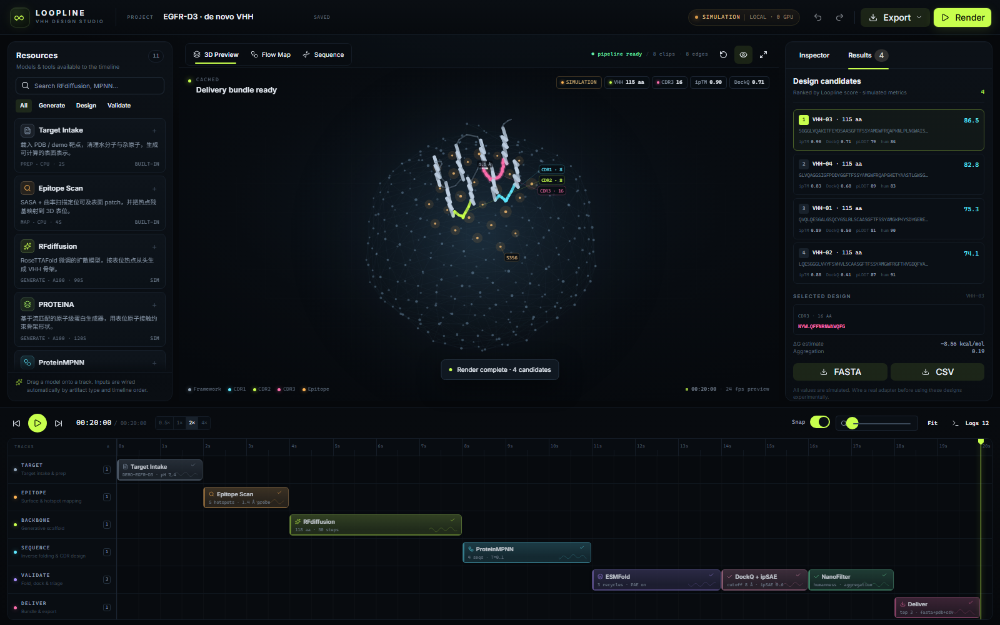
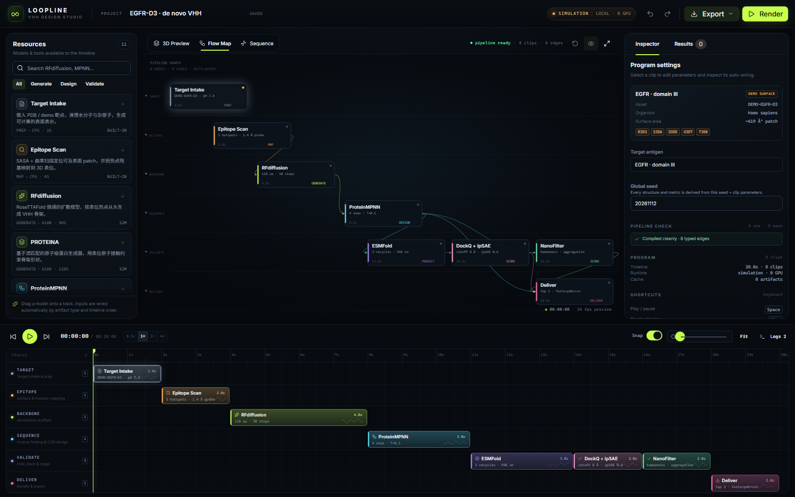
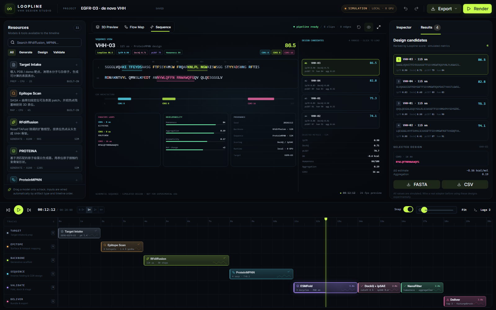
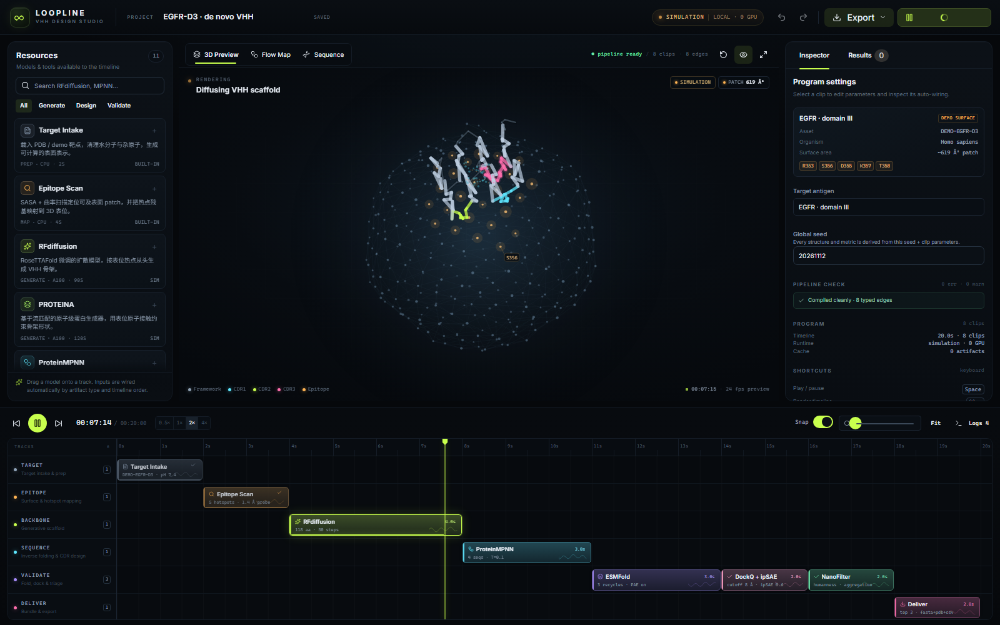
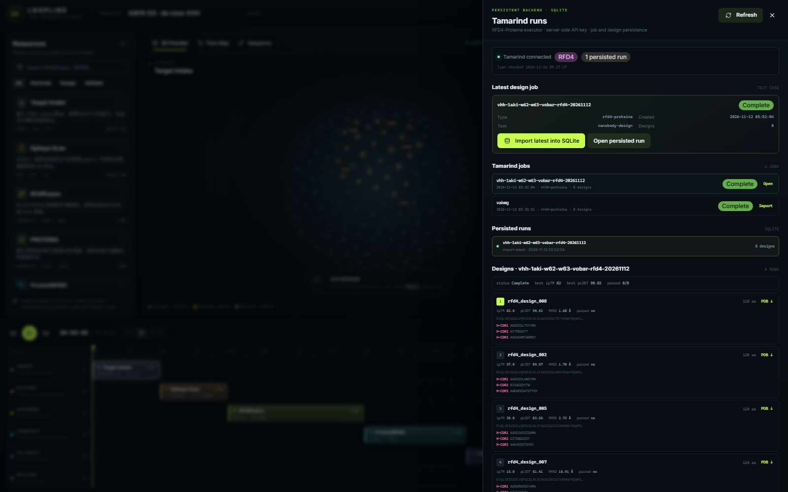
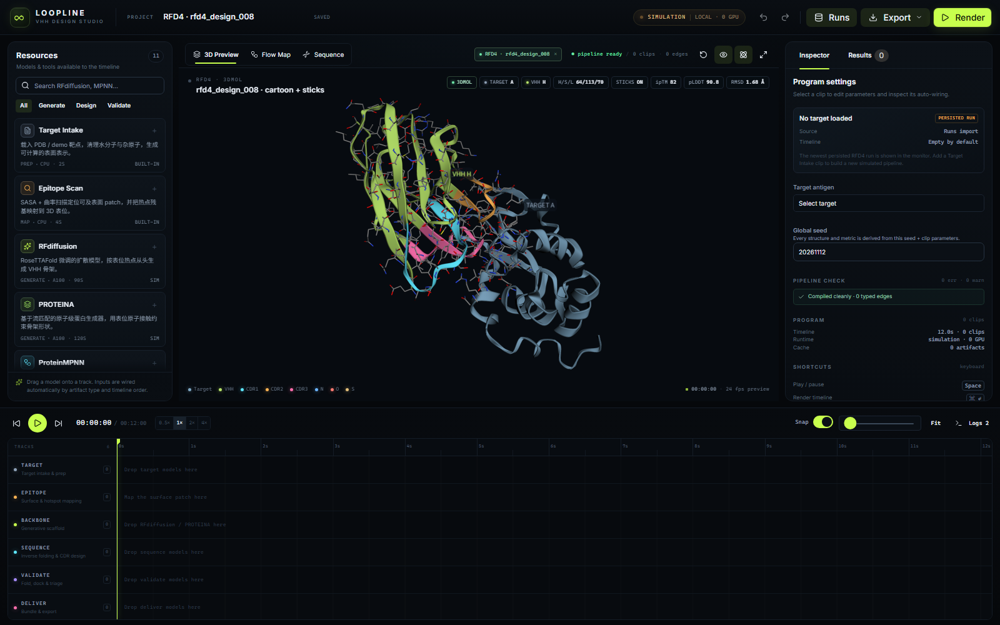

# Loopline · VHH Design Studio

> **Epitope in. Nanobody out.** 把 VHH 从头设计做成一个像剪视频一样的时间线工作台。
>
> 模型是素材，片段是计算，播放头是当前设计状态，监视器里同时看到结构、序列和工作流本身。



## 这是什么

Loopline 是一个**表位驱动的 VHH（纳米抗体）设计平台 / 引擎原型**。前端使用 **React 19 + Astryx** 重构，在浏览器里提供一套非线性编辑器（NLE）式的工作流：

- **Resources**：RFdiffusion、PROTEINA、ProteinMPNN、AntiFold、ESMFold、Boltz-2、DockQ/ipSAE、NanoFilter……每个模型都是一张可拖拽的"素材卡"。
- **Timeline**：6 条轨道 = 6 个设计阶段。片段的先后顺序自动编译成带类型的 DAG，无需手动连线。
- **Monitor**：同一个播放头驱动三种视图——可旋转的 3D 复合物示意、Flow Map 工作流、Sequence 设计序列。
- **Inspector**：按模型声明自动生成参数表单，展示自动接线、诊断与结果。
- **Render**：像导出成片一样运行整条 pipeline，逐片段产生 artifact、日志、排序候选和可导出的 FASTA/PDB/CSV。

> ⚠️ **MVP 使用确定性模拟运行时。** 结构是程序化示意，指标是模拟值，全部全局标注 `SIMULATION`，导出的 PDB 也带 `SIMULATION OUTPUT` 与"不可用于实验"的 REMARK。真实模型接入点已经留好（见下文 Adapter）。

## 技术栈

- **React 19 + TypeScript + Vite 8**：前端组件化与构建。
- **Astryx 0.7（Meta 开源设计系统，Beta）**：`@astryxdesign/core` + `@astryxdesign/theme-neutral`。按钮、图标按钮、Tabs、Slider、Switch、TextInput、Badge、Tooltip 都来自 Astryx；自定义 Loopline dark theme 通过 `defineTheme()` 把 Astryx token 对齐到时间线的酸橙 / 深色调色板。
- **Canvas 2D**：3D 结构、Flow Map、Sequence 三段监视器仍是命令式 Canvas 渲染，由 React 组件托管生命周期与指针交互。
- **纯 JS engine**：编译器、运行时、几何、序列与导出器保持与 UI 无关，便于测试和接真实 GPU。

## 持久化后端 · Tamarind RFD4

前端保持不变，新增一个 Node 持久化后端：

- **SQLite**：`data/loopline.db`（Node 内置 `node:sqlite`，WAL 模式），保存项目快照、Tamarind run、设计序列、指标、PDB 和事件日志。
- **Tamarind Bio 单执行器**：`rfd4-proteina` / `nanobody-design`。
- **API key 只在服务端**：从 `.env` 读取，不进入前端 bundle，也不通过 API 返回。
- **RFD4 闭环**：`GET /api/tamarind/jobs` → `POST /api/tamarind/import-latest` → 下载 Tamarind 结果 ZIP → 解析 `results.csv` + 8 个 PDB → 写入 SQLite → 在 UI 的 **Runs** 抽屉中展示。
- **真实结果进监视器**：Runs 里点 **Open persisted run** 会把最佳 design 的 backbone ribbon + **all-atom side-chain sticks** 载入主 Canvas（helix / β-sheet / loop；target / VHH / CDR 分色），也可以对单个 design 点 **View 3D**。二级结构由 PDB 的 N/CA/C/O 骨架二面角做 DSSP-lite 判定，不是 Cα 折线。
- **提交闭环**：`POST /api/tamarind/validate` 先校验；`POST /api/tamarind/submit` 提交真实 GPU job，后台每 15s 轮询 `/jobs`，完成后自动导入结果。

### 本地配置

```bash
cp .env.example .env
# 编辑 .env：TAMARIND_API_KEY=...
npm install
npm start
```

`.env`、`data/`、`dist/`、`node_modules/` 都不提交。

### API

| Method | Path | 作用 |
| --- | --- | --- |
| GET | `/api/health` | SQLite / Tamarind 配置状态 |
| GET | `/api/projects` / `/api/projects/:id` | 项目快照 |
| PUT | `/api/projects/:id` | 前端 debounce 自动保存项目 |
| GET | `/api/runs` / `/api/runs/:id` | 持久化 run 与设计 |
| POST | `/api/runs/:id/sync` | 手动同步一个 Tamarind run |
| GET | `/api/designs/:id/pdb` | 下载真实设计 PDB |
| GET | `/api/designs/:id/structure` | 解析 all atoms / bonds / secondary structure / chains / CDR，供 ribbon 与 sticks 渲染 |
| GET | `/api/tamarind/jobs` | 列出账号 job + 最近设计 job |
| POST | `/api/tamarind/import-latest` | 导入最新完成的设计 job |
| POST | `/api/tamarind/import` | 按 jobName 导入 |
| POST | `/api/tamarind/validate` | 无成本校验 RFD4 settings |
| POST | `/api/tamarind/submit` | 提交 RFD4 并开始轮询 |

### 已核对的最新测试 job

通过 API 在账号里查到两个 `rfd4-proteina` 结果，最新的是：

```text
vhh-1aki-w62-w63-vobar-rfd4-20261112
Created: 2026-11-12 05:52:04
Task:    nanobody-design
Designs: 8
```

已成功导入 SQLite，最佳候选：

```text
rfd4_design_008   118 aa
ipTM 82.0 · pLDDT 90.82 · refold RMSD 1.68 Å · passed 0/8
```

RFD4 提交设置（target chain A、hotspots 62,63、vobarilizumab、8 designs、thinking_high、60 steps、seed 20261112）已通过 Tamarind `/validate-job` 返回 `valid: true`。验证阶段没有实际提交新 GPU job；`/submit` 路径已接好，提交后会自动轮询并导入。

点 **Open persisted run** 会把 `rfd4_design_008` 的真实 backbone ribbon + side-chain sticks（helix / β-sheet / loop）载入主监视器；在 Runs 详情里可以点单个 design 的 **View 3D** 切换。Stage 栏的 atom 按钮可以开关 side-chain sticks。


## 快速开始

要求：Node.js ≥ 24（开发时使用 Node 26，`node:sqlite` 已内置）。

```bash
cd vhh-studio
cp .env.example .env      # 填入 TAMARIND_API_KEY
npm install
npm start
# prestart 会先执行 vite build，然后由 server.mjs 提供 dist/
# → http://127.0.0.1:4173
```

开发模式（Vite HMR，端口 5173；`/api` 会代理到 4173，需同时运行后端）：

```bash
# terminal 1
npm start

# terminal 2
npm run dev
```

其他命令：

```bash
npm run build             # 生产构建到 dist/
npm run typecheck         # tsc --noEmit
npm test                  # 引擎 / 后端 / 导出器 15 个测试
node tools/cdp.mjs render shots/02-render.png   # 需要本机 Chrome + 已启动 4173
```

首次打开会载入一个 8 片段的 EGFR-D3 demo 时间线。按 **Space** 播放，或点右上角 **Render**，约 10 秒后得到 4 个候选设计。

> Astryx 目前是 Beta；本项目锁定 `@astryxdesign/core@0.7.16`。Astryx 的安装脚本可能被 npm 的 allowScripts 策略拦截，但预编译 CSS/JS 仍可正常构建与运行。

## 截图

| 3D Preview（渲染完成） | Flow Map |
| --- | --- |
|  |  |

| Sequence Viewer | 初始时间线 |
| --- | --- |
|  |  |

| 渲染中：RFdiffusion 片段激活，骨架逐步凝实 |
| --- |
|  |

| Tamarind Runs · RFD4 job 导入与设计明细 |
| --- |
|  |

| 真实 RFD4 design · backbone ribbon + all-atom side-chain sticks |
| --- |
|  |

> 建议使用 Chrome / Edge 120+；界面用到 `color-mix()`、`backdrop-filter`、`ResizeObserver`。

## 核心交互

| 操作 | 行为 |
| --- | --- |
| 从 Resource 拖到时间线 | 在模型原生轨道上创建片段；落点自动吸附 |
| 点击 Resource 卡片 | 在播放头位置添加片段 |
| 拖动片段 | 横向移动时间、纵向跨轨；自动避让同轨重叠 |
| 拖片段右边缘 | 裁剪时长（= 算力预算的可视化） |
| 拖动标尺 / 点击空轨 | Scrub 播放头；重新计算监视器状态 |
| 点击片段 | 在 Inspector 中编辑参数、查看自动接线 |
| `Space` | 播放 / 暂停 |
| `Ctrl/Cmd + Enter` | Render 整条时间线 |
| `Delete` / `Backspace` | 删除选中片段 |
| `Ctrl/Cmd + Z` / `Shift + Ctrl/Cmd + Z` | 撤销 / 重做 |
| `1` / `2` / `3` | 3D / Flow / Sequence 视图 |
| `L` | 打开渲染日志 |

## 引擎模型

### 片段即计算

```js
{
  id: 'clp_rfd_01',
  modelId: 'rfdiffusion',
  track: 'backbone',
  start: 4, duration: 4,
  params: { length: 118, steps: 50, hotspots: 'R353,S356,D355,K357,T358' }
}
```

每个模型声明 `inputs / output / params / adapter`。Compiler 按开始时间排序，把每个输入接到**在它开始前已完成**的最近一个同类型产物上：

```
target ──▶ epitope ──▶ backbone ──▶ sequence ──▶ complex ──▶ metrics ──▶ deliverable
                                  └────────────▶ profile ──┘
```

- 缺输入 → 运行前报错，并直接定位到片段。
- 上游尚未结束、下游就开始了 → 报错（NLE 语义下"素材还没渲染完"）。
- 同轨重叠 → warning；拖拽时自动推到最近的空位。
- 任何参数 / 时间修改 → 清空 artifact 缓存，时间线进入待渲染状态。

### 播放头语义

- **Scrub 不计算**：只显示时间 ≤ 播放头且已完成的片段产物。
- **Play 跨越片段末尾**：触发该片段的 artifact 计算（真实适配器下是异步作业）。
- **Render**：归零 → 2× 播放 → 完成后自动切到 Results。
- 结构随阶段出现：Target surface → 表位高亮 → 骨架凝实（diffusion 粒子）→ CDR 序列 → 复合物与指标。

### 目录

```
vhh-studio/
├─ index.html                 # Vite entry
├─ vite.config.ts
├─ tsconfig.json
├─ server.mjs                 # 静态前端 + /api 路由 + SQLite 初始化
├─ backend/
│  ├─ api.js                  # REST routes
│  ├─ db.js                   # node:sqlite schema / repositories
│  ├─ tamarind.js             # API client + result ZIP/CSV/PDB parsing
│  ├─ pdb.js                  # backbone SS assignment + chain/CDR parser
│  ├─ runner.js               # RFD4 submit / poll / import
│  └─ config.js               # .env / data dir
├─ data/                      # SQLite runtime data（gitignored）
├─ .env.example
├─ src/
│  ├─ main.tsx                # React root + Astryx Theme
│  ├─ App.tsx                 # shell / keyboard / layout
│  ├─ theme.ts                # defineTheme(neutral) → Loopline palette
│  ├─ app.css                 # Astryx bridge + React region styles
│  ├─ styles.css              # studio visual system (timeline / monitor / panels)
│  ├─ state.js                # 项目状态、播放头、撤销、持久化、导出
│  ├─ components/
│  │  ├─ Topbar.tsx           # project, runtime, undo/redo, export, render
│  │  ├─ Library.tsx          # Astryx search + model cards + templates
│  │  ├─ Stage.tsx            # Astryx Tabs + legacy canvas mount
│  │  ├─ Timeline.tsx         # React NLE: drag/trim/scrub/snap/drop
│  │  ├─ Inspector.tsx        # Astryx fields, diagnostics, results
│  │  ├─ LogsDrawer.tsx
│  │  └─ Toasts.tsx
│  ├─ lib/                    # app-event hook + Lucide icon map
│  ├─ engine/
│  │  ├─ models.js            # 11 个模型、6 条轨道、3 套模板
│  │  ├─ compiler.js          # timeline → typed DAG + diagnostics
│  │  ├─ runtime.js           # playhead 驱动的模拟运行时
│  │  ├─ structure.js         # 程序化几何、序列设计、PDB/FASTA/CSV
│  │  └─ rng.js               # 确定性 seed / timecode
│  └─ ui/
│     ├─ monitor.js           # imperative Canvas renderer (3D / Flow / Sequence)
│     └─ dom.js
├─ tests/engine.test.mjs
├─ tools/cdp.mjs              # headless Chrome 截图 / 交互 smoke test
├─ dist/                      # vite build 输出（已 gitignore）
└─ docs/DESIGN.md             # 产品设计方案
```

## 前端架构

```
main.tsx
  └─ <Theme theme={looplineTheme} mode="dark">  ← Astryx provider
       └─ <App>                                 ← one LooplineApp store
            ├─ <Topbar>        Astryx Button / IconButton
            ├─ <Library>       Astryx TextInput / Button
            ├─ <Stage>         Astryx TabList + <MonitorCanvas>
            ├─ <Inspector>     Astryx TabList / TextInput / Slider / Switch / Badge
            ├─ <Timeline>      Astryx IconButton / Slider / Switch + custom clip layer
            ├─ <LogsDrawer>
            └─ <Toasts>
```

`LooplineApp`（`src/state.js`）保留原有 store/命令 API；React 组件通过 `useAppEvents` 订阅其事件，不直接操作 DOM。唯一的 imperative 部分是 `src/ui/monitor.js` 的 Canvas 渲染循环，它由 `<Stage>` 在挂载时创建、卸载时 `destroy()`。

## 模型资源

| 模型 | 能力 | 类型 | 状态 |
| --- | --- | --- | --- |
| Target Intake | PDB / demo 表面准备 | built-in | ✅ |
| Epitope Scan | SASA + hotspot 映射 | built-in | ✅ |
| RFdiffusion | 表位条件骨架扩散 | backbone | SIM |
| PROTEINA | 原子接触约束的流匹配生成 | backbone | SIM |
| ProteinMPNN | 逆折叠 / CDR 设计 | sequence | SIM |
| AntiFold | 抗体专用逆折叠 | sequence | SIM |
| ESMFold | 快速回折 | structure | SIM |
| Boltz-2 | 复合物预测 + 亲和力 | structure | SIM |
| DockQ + ipSAE | 界面打分 | score | built-in（模拟指标） |
| NanoFilter | 人源化 / 聚集 / PTM | score | built-in（模拟指标） |
| Deliver | FASTA + PDB + CSV + provenance | deliver | ✅ |

## 接真实模型

MVP 的 `Engine.computeArtifact()` 是同步模拟实现。接真实 GPU 时保持 artifact 契约不变，把计算换成异步 adapter：

```ts
interface Adapter {
  submit(clip, inputs, ctx): Promise<JobHandle>
  poll(handle): Promise<{ progress: number; logs: string[] }>
  fetch(handle): Promise<Artifact>
  cancel(handle): Promise<void>
}
```

推荐路径：

1. **Tamarind Bio**：服务端 `POST /api/v1/jobs` 提交 RFdiffusion / ProteinMPNN / ESMFold；轮询 job；下载 PDB/FASTA；映射为 `target / epitope / backbone / sequence / complex` artifact。密钥只放在服务端。
2. **本地 GPU**：把 RFdiffusion、ProteinMPNN、ESMFold 包装成 HTTP/gRPC worker，前端仍只认 artifact。
3. **内容寻址缓存**：`hash(modelId + params + seed + upstreamKeys)` 作为 artifact key，接 Redis/S3 后可跨会话复用。
4. **队列与取消**：把 `Engine` 的 `ensureArtifact()` 改成 Promise，播放头跨越片段末尾时提交作业，监视器显示 job progress。

> 接真实模型前请保持 UI 中的 `SIMULATION` 标识逻辑：真实结果应切换为 `PREDICTED`，并展示模型版本、权重 hash、运行时长与随机种子。

## 设计文档

完整的产品设计、NLE 类比、信息架构、数据模型、MVP 范围与路线图见：

- [`docs/DESIGN.md`](docs/DESIGN.md)

## MVP 边界

**已实现**：时间线编辑、自动编译、播放/渲染、3D/Flow/Sequence 监视器、参数检查器、结果排序、日志、撤销、本地持久化、JSON/FASTA/PDB/CSV 导出、3 套模板、确定性模拟引擎、15 个测试；**SQLite 持久化 + Tamarind RFD4 job 导入 / 校验 / 提交 / 轮询闭环 + backbone ribbon / all-atom side-chain sticks 监视器**。

**未实现**：全原子 ribbon 精度（当前 ribbon 为骨架 cartoon 近似并存 side-chain sticks，不是 explicit-H 全原子模型）、其他 Tamarind 模型、真实 PDB/mmCIF 输入解析、多链/配体、湿实验验证、协作、完整作业队列 UI。设计工作流中的结构和指标仍为模拟值。

## 路线图

- **v0.3** 持久化后端 + Tamarind RFD4 单执行器 + ribbon / side-chain sticks 监视器（已落地）
- **v0.4** explicit-H 全原子 ribbon、结果版本对比、Compound Clip
- **v0.5** 并行轨道 / A-B 对照、更多 Tamarind 模型、作业取消
- **v1.0** 3D 表面刷选表位、CDR 锁定、湿实验反馈闭环、团队资源库
