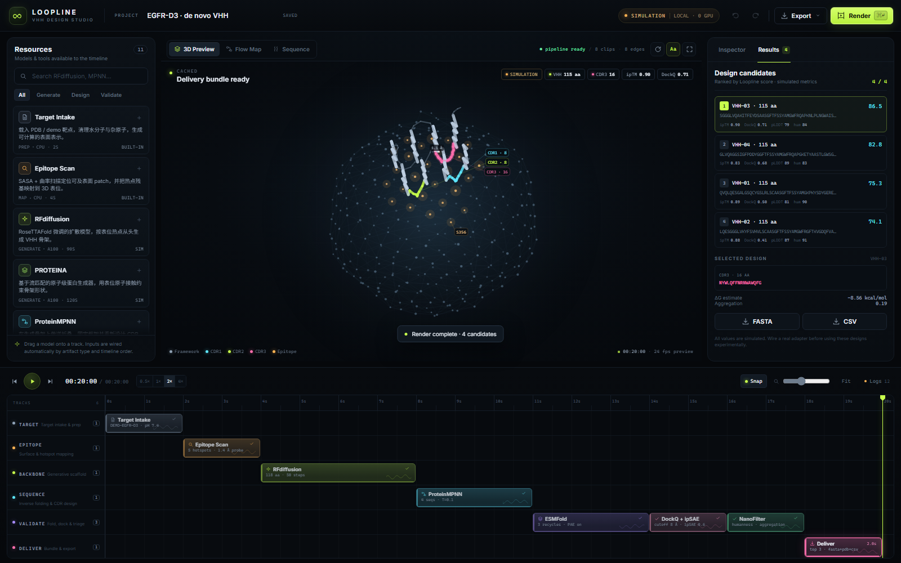
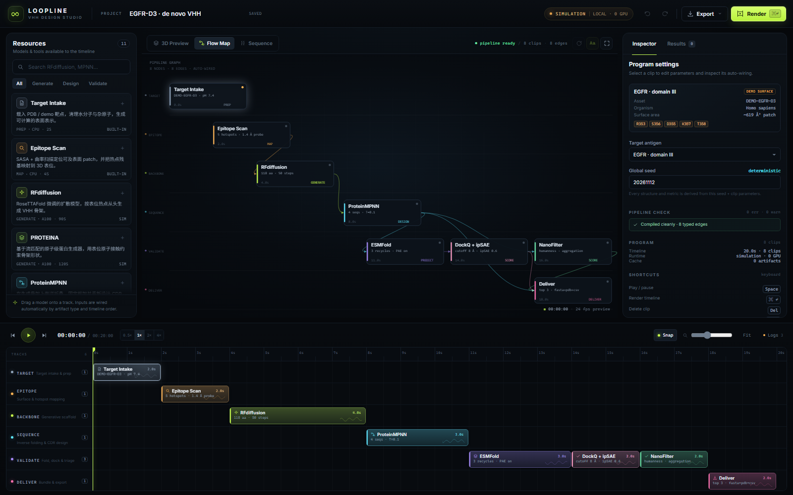
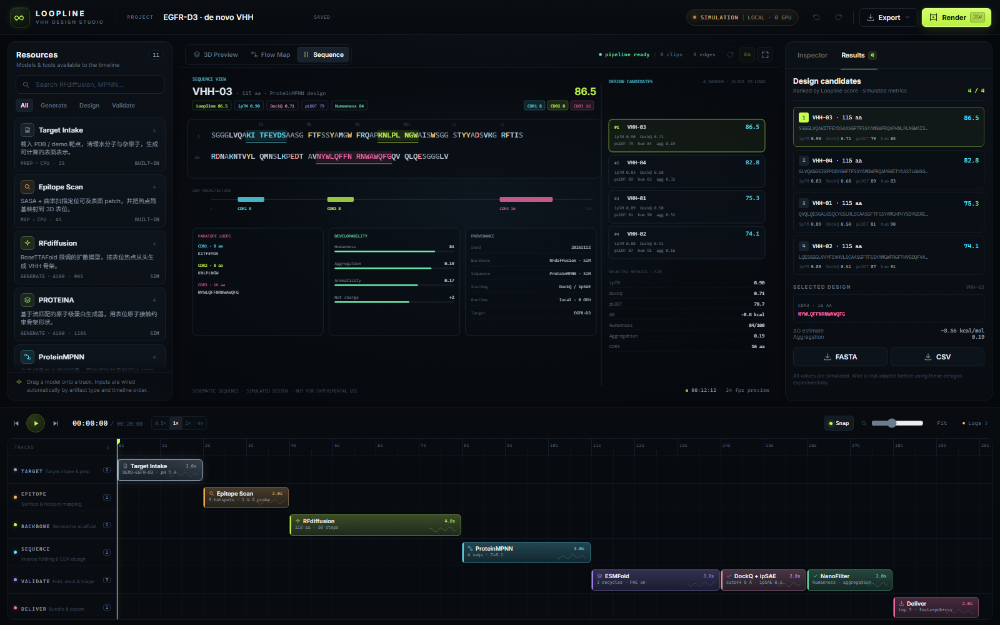
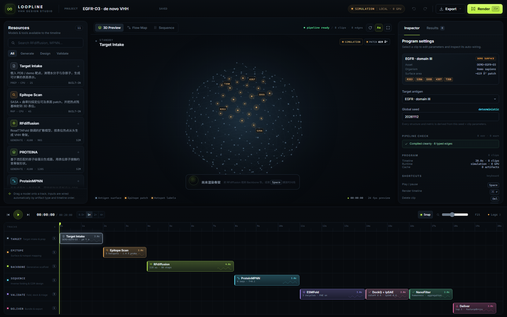
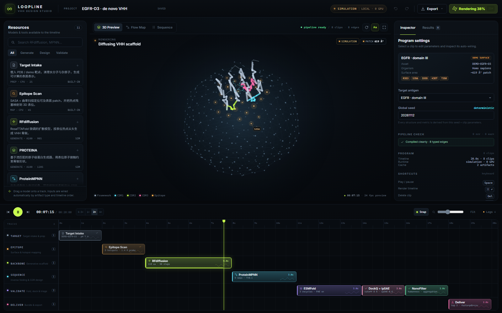

# Loopline · VHH Design Studio

> **Epitope in. Nanobody out.** 把 VHH 从头设计做成一个像剪视频一样的时间线工作台。
>
> 模型是素材，片段是计算，播放头是当前设计状态，监视器里同时看到结构、序列和工作流本身。



## 这是什么

Loopline 是一个**表位驱动的 VHH（纳米抗体）设计平台 / 引擎原型**。它在浏览器里提供一套非线性编辑器（NLE）式的工作流：

- **Resources**：RFdiffusion、PROTEINA、ProteinMPNN、AntiFold、ESMFold、Boltz-2、DockQ/ipSAE、NanoFilter……每个模型都是一张可拖拽的"素材卡"。
- **Timeline**：6 条轨道 = 6 个设计阶段。片段的先后顺序自动编译成带类型的 DAG，无需手动连线。
- **Monitor**：同一个播放头驱动三种视图——可旋转的 3D 复合物示意、Flow Map 工作流、Sequence 设计序列。
- **Inspector**：按模型声明自动生成参数表单，展示自动接线、诊断与结果。
- **Render**：像导出成片一样运行整条 pipeline，逐片段产生 artifact、日志、排序候选和可导出的 FASTA/PDB/CSV。

> ⚠️ **MVP 使用确定性模拟运行时。** 结构是程序化的 CA trace 示意图，指标是模拟值，全部全局标注 `SIMULATION`，导出的 PDB 也带 `SIMULATION OUTPUT` 与"不可用于实验"的 REMARK。真实模型接入点已经留好（见下文 Adapter）。

## 快速开始

要求：Node.js ≥ 18（零运行时依赖）。

```bash
cd vhh-studio
npm start
# → http://127.0.0.1:4173
```

其他命令：

```bash
npm test                  # 编译 / 运行时 / 导出器共 10 个测试
node tools/cdp.mjs render shots/02-render.png   # 需要本机 Chrome + 已启动 server
```

首次打开会载入一个 8 片段的 EGFR-D3 demo 时间线。按 **Space** 播放，或点右上角 **Render**，约 10 秒后得到 4 个候选设计。

## 截图

| 3D Preview（渲染完成） | Flow Map |
| --- | --- |
|  |  |

| Sequence Viewer | 初始时间线 |
| --- | --- |
|  |  |

| 渲染中：RFdiffusion 片段激活，骨架逐步凝实 |
| --- |
|  |

> 建议使用 Chrome / Edge 120+；界面用到 `color-mix()`、`backdrop-filter`、`ResizeObserver`。

## 核心交互

| 操作 | 行为 |
| --- | --- |
| 从 Resource 拖到时间线 | 在模型原生轨道上创建片段；落点自动吸附 |
| 点击 Resource 卡片 | 在播放头位置添加片段 |
| 拖动片段 | 横向移动时间、纵向跨轨；自动避让同轨重叠 |
| 拖片段右边缘 | 裁剪时长（= 算力预算的可视化） |
| 拖动标尺 / 点击空轨 | Scrub 播放头；重新计算监视器状态 |
| 点击片段 | 在 Inspector 中编辑参数、查看自动接线 |
| `Space` | 播放 / 暂停 |
| `Ctrl/Cmd + Enter` | Render 整条时间线 |
| `Delete` / `Backspace` | 删除选中片段 |
| `Ctrl/Cmd + Z` / `Shift + Ctrl/Cmd + Z` | 撤销 / 重做 |
| `1` / `2` / `3` | 3D / Flow / Sequence 视图 |
| `L` | 打开渲染日志 |

## 引擎模型

### 片段即计算

```js
{
  id: 'clp_rfd_01',
  modelId: 'rfdiffusion',
  track: 'backbone',
  start: 4, duration: 4,
  params: { length: 118, steps: 50, hotspots: 'R353,S356,D355,K357,T358' }
}
```

每个模型声明 `inputs / output / params / adapter`。Compiler 按开始时间排序，把每个输入接到**在它开始前已完成**的最近一个同类型产物上：

```
target ──▶ epitope ──▶ backbone ──▶ sequence ──▶ complex ──▶ metrics ──▶ deliverable
                                  └────────────▶ profile ──┘
```

- 缺输入 → 运行前报错，并直接定位到片段。
- 上游尚未结束、下游就开始了 → 报错（NLE 语义下"素材还没渲染完"）。
- 同轨重叠 → warning；拖拽时自动推到最近的空位。
- 任何参数 / 时间修改 → 清空 artifact 缓存，时间线进入待渲染状态。

### 播放头语义

- **Scrub 不计算**：只显示时间 ≤ 播放头且已完成的片段产物。
- **Play 跨越片段末尾**：触发该片段的 artifact 计算（真实适配器下是异步作业）。
- **Render**：归零 → 2× 播放 → 完成后自动切到 Results。
- 结构随阶段出现：Target surface → 表位高亮 → 骨架凝实（diffusion 粒子）→ CDR 序列 → 复合物与指标。

### 目录

```
vhh-studio/
├─ index.html
├─ src/
│  ├─ styles.css
│  ├─ main.js                  # shell：topbar / transport / shortcuts / logs
│  ├─ state.js                 # 项目状态、播放头、撤销、持久化、导出
│  ├─ engine/
│  │  ├─ models.js             # 11 个模型、6 条轨道、3 套模板
│  │  ├─ compiler.js           # timeline → typed DAG + diagnostics
│  │  ├─ runtime.js            # playhead 驱动的模拟运行时
│  │  ├─ structure.js          # 程序化几何、序列设计、PDB/FASTA/CSV
│  │  └─ rng.js                # 确定性 seed / timecode
│  └─ ui/
│     ├─ timeline.js           # 拖拽、裁剪、scrub、缩放、snap、drop
│     ├─ monitor.js            # Canvas：3D / Flow Map / Sequence
│     ├─ inspector.js          # 参数、接线、诊断、结果
│     ├─ library.js            # 模型与模板
│     └─ dom.js
├─ tests/engine.test.mjs
├─ tools/cdp.mjs               # headless Chrome 截图 / 交互 smoke test
└─ docs/DESIGN.md              # 产品设计方案
```

## 模型资源

| 模型 | 能力 | 类型 | 状态 |
| --- | --- | --- | --- |
| Target Intake | PDB / demo 表面准备 | built-in | ✅ |
| Epitope Scan | SASA + hotspot 映射 | built-in | ✅ |
| RFdiffusion | 表位条件骨架扩散 | backbone | SIM |
| PROTEINA | 原子接触约束的流匹配生成 | backbone | SIM |
| ProteinMPNN | 逆折叠 / CDR 设计 | sequence | SIM |
| AntiFold | 抗体专用逆折叠 | sequence | SIM |
| ESMFold | 快速回折 | structure | SIM |
| Boltz-2 | 复合物预测 + 亲和力 | structure | SIM |
| DockQ + ipSAE | 界面打分 | score | built-in（模拟指标） |
| NanoFilter | 人源化 / 聚集 / PTM | score | built-in（模拟指标） |
| Deliver | FASTA + PDB + CSV + provenance | deliver | ✅ |

## 接真实模型

MVP 的 `Engine.computeArtifact()` 是同步模拟实现。接真实 GPU 时保持 artifact 契约不变，把计算换成异步 adapter：

```ts
interface Adapter {
  submit(clip, inputs, ctx): Promise<JobHandle>
  poll(handle): Promise<{ progress: number; logs: string[] }>
  fetch(handle): Promise<Artifact>
  cancel(handle): Promise<void>
}
```

推荐路径：

1. **Tamarind Bio**：服务端 `POST /api/v1/jobs` 提交 RFdiffusion / ProteinMPNN / ESMFold；轮询 job；下载 PDB/FASTA；映射为 `target / epitope / backbone / sequence / complex` artifact。密钥只放在服务端。
2. **本地 GPU**：把 RFdiffusion、ProteinMPNN、ESMFold 包装成 HTTP/gRPC worker，前端仍只认 artifact。
3. **内容寻址缓存**：`hash(modelId + params + seed + upstreamKeys)` 作为 artifact key，接 Redis/S3 后可跨会话复用。
4. **队列与取消**：把 `Engine` 的 `ensureArtifact()` 改成 Promise，播放头跨越片段末尾时提交作业，监视器显示 job progress。

> 接真实模型前请保持 UI 中的 `SIMULATION` 标识逻辑：真实结果应切换为 `PREDICTED`，并展示模型版本、权重 hash、运行时长与随机种子。

## 设计文档

完整的产品设计、NLE 类比、信息架构、数据模型、MVP 范围与路线图见：

- [`docs/DESIGN.md`](docs/DESIGN.md)

## MVP 边界

**已实现**：时间线编辑、自动编译、播放/渲染、3D/Flow/Sequence 监视器、参数检查器、结果排序、日志、撤销、本地持久化、JSON/FASTA/PDB/CSV 导出、3 套模板、确定性模拟引擎、10 个引擎测试。

**未实现**：真实推理、真实 PDB/mmCIF 解析、多链/配体、湿实验验证、协作、服务端队列、真实能量计算。所有数值仅用于交互演示。

## 路线图

- **v0.2** Tamarind Bio adapter、mmCIF 解析、作业队列与取消
- **v0.3** 并行轨道 / A-B 对照、Compound Clip、结果版本对比
- **v0.4** 3D 表面刷选表位、CDR 锁定、湿实验反馈闭环
- **v1.0** 团队资源库、provenance 审计、ELN/LIMS 导出
